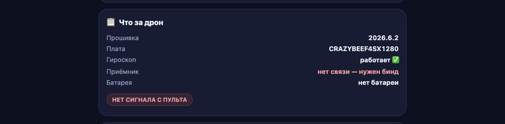
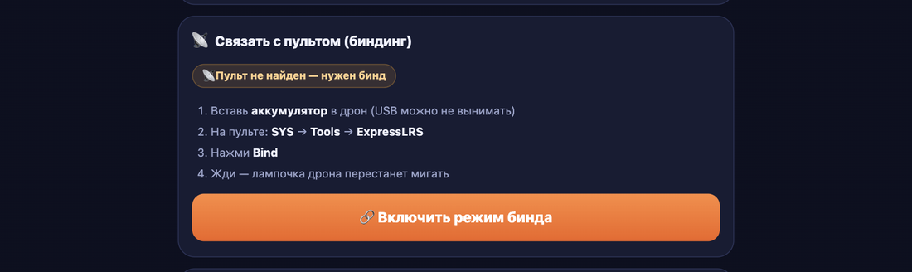
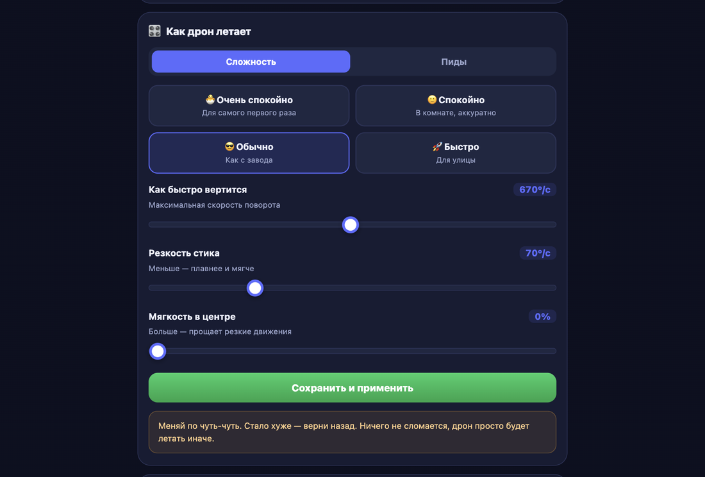
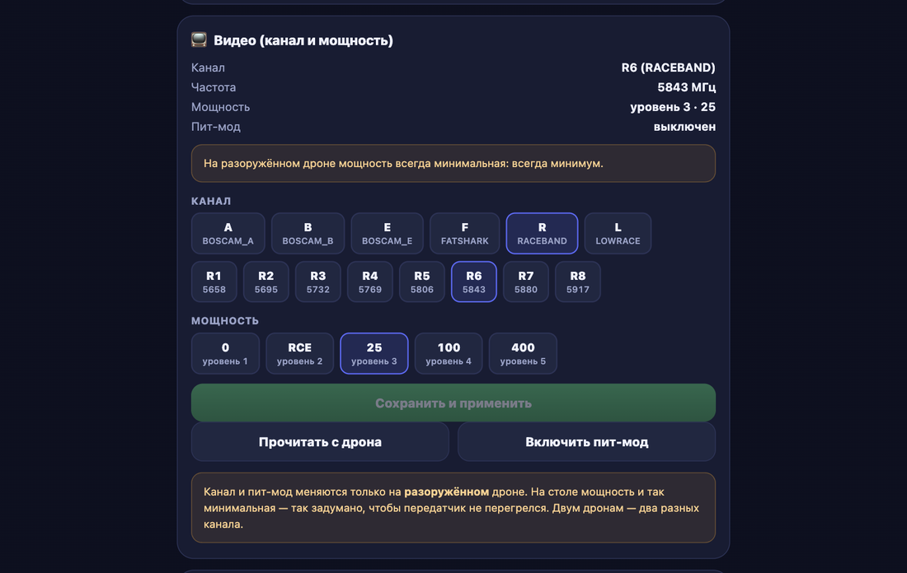
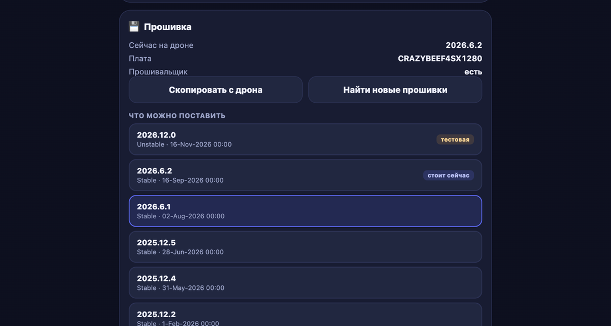

# Mobula6 — помощник для настройки

Простое приложение в браузере: показывает, подключён ли дрон, помогает связать его с пультом,
позволяет менять пиды и «сложность» управления, настраивать видео и прошивать дрон.
Без Betaflight Configurator.

Работает одинаково на **Windows**, **macOS** и **Linux** — из одной и той же папки,
ничего устанавливать не нужно.

## Что скачать

Выбери свою систему — остальное качать не нужно:

| Система | Файл | Размер |
|---|---|---|
| **Windows** 10 / 11 (64-бит) | [Mobula6-Windows-1.0.0.zip](https://github.com/permyakov344-png/mobula6-helper/releases/latest/download/Mobula6-Windows-1.0.0.zip) | 12 МБ |
| **macOS**, Apple Silicon (M1–M4) | [Mobula6-macOS-AppleSilicon-1.0.0.zip](https://github.com/permyakov344-png/mobula6-helper/releases/latest/download/Mobula6-macOS-AppleSilicon-1.0.0.zip) | 0,8 МБ |
| **macOS**, Intel | [Mobula6-macOS-Intel-1.0.0.zip](https://github.com/permyakov344-png/mobula6-helper/releases/latest/download/Mobula6-macOS-Intel-1.0.0.zip) | 0,8 МБ |
| **Linux** (64-бит) | [Mobula6-Linux-1.0.0.zip](https://github.com/permyakov344-png/mobula6-helper/releases/latest/download/Mobula6-Linux-1.0.0.zip) | 1 МБ |

Не знаешь, какой у тебя Mac? Меню Apple → **Об этом Mac**. Если написано
«Apple M1/M2/M3/M4» — бери Apple Silicon, если «Intel» — Intel.

Распакуй архив и запусти `start.bat` (Windows) или `start.command` (macOS, Linux).

Всё остальное — исходники, отдельные `dfu-util` под каждую систему, встроенный
Python — лежит в репозитории, но для работы оно не нужно: в архивах уже всё есть.

## Как открыть

**Windows:** двойной клик по **`start.bat`**.

**macOS:** двойной клик по **`start.command`**.

Скрипт поднимет локальный помощник и сам откроет страницу в браузере.
Подключи дрон кабелем USB и нажми **«Подключить дрон»**.

Никаких окон выбора порта: USB открывает помощник на компьютере, а страница
общается с ним по `http://localhost`. Поэтому подключение одинаково работает
в любом браузере — Chrome, Edge, Яндекс, Opera и даже Safari.

Safari раньше не подходил (в нём нет Web Serial), но теперь это не важно:
Web Serial нужен только как запасной путь, когда помощника нет.

Если на macOS файл не открывается двойным кликом (ругается на «неизвестного
разработчика»): правый клик по файлу → **Открыть** → **Открыть**.

Если на Windows появилось окно «Windows защитила ваш компьютер»:
**Подробнее** → **Выполнить в любом случае**.

Окно консоли держи **открытым**: это и есть помощник. Закроешь окно — связь
с дроном оборвётся (страница об этом скажет).

**Linux:** двойной клик по **`start.command`** (или в терминале `./start.command`).
Нужен Perl — он есть в любом обычном дистрибутиве; Python тоже подойдёт.


## Если дрон не находится

Чаще всего помогает одно из двух:

- **Дрон в режиме джойстика.** Если дрон подключён для симулятора (Liftoff и подобные),
  система видит его как `BETAFPV Joystick`, и настройки из него не читаются.
  Выключи режим симулятора (или перезаткни USB) — дрон снова станет `Betaflight`
  / `USB Serial`, и приложение его найдёт.
- **Дрон занят другой программой.** Betaflight Configurator и другие настройщики
  держат порт. Закрой их.
- **Запущено два помощника.** Если осталось окно консоли от прошлого запуска,
  закрой его. Теперь второй экземпляр сам не стартует, но старые версии
  приложения так не умели.

Приложение не примет за дрон постороннее устройство: помощник сначала спрашивает
у порта версию прошивки по MSP и подключается, только если порт ответил. Поэтому
вместо мусорных данных ты увидишь понятное сообщение.

## Что внутри

| Файл | Зачем |
|---|---|
| `index.html` | само приложение: интерфейс, MSP, пиды, рейты, видео, прошивка |
| `bridge.py` | локальный помощник на Python: открывает USB-порт и передаёт MSP |
| `bridge.pl` | тот же помощник на Perl — нужен там, где нет Python |
| `start.command` | запуск в один клик на macOS/Linux |
| `start.bat` | запуск в один клик на Windows |
| `runtime/win/python` | готовый Python для Windows, чтобы ничего не устанавливать |
| `tools/win`, `tools/mac-arm64`, `tools/mac-x64`, `tools/linux` | `dfu-util` — программа, которая пишет прошивку в дрон |
| `_lib/serial` | готовая библиотека `pyserial`, чтобы ничего не устанавливать |
| `backups` | сюда сохраняются дампы настроек и скачанные прошивки (создаётся при первом использовании) |

Помощник выбирается автоматически:

- есть рабочий Python → `bridge.py` (если `pyserial` нет, поставит сам; а если лежит `_lib`, возьмёт оттуда);
- Python нет (например, на новом Mac без инструментов разработчика) → `bridge.pl`.

Perl в macOS есть всегда, поэтому на любом Маке приложение запускается **без установки
чего-либо**. На Windows Python уже лежит внутри папки, в `runtime/win/python`.

Запустить вручную:

```bash
cd ~/Desktop/Mobula6_для_мини
perl bridge.pl 8000 --open    # или: python3 bridge.py 8000 --open
```

`--open` сразу открывает страницу в браузере; без него помощник просто печатает адрес.
Порт помощник подбирает сам (8000 и дальше) и пишет его в файл `port.txt`.

Второй экземпляр запускать не нужно, и он сам не запустится: если помощник уже
работает, новый просто откроет его страницу и закроется. Это важно — два
процесса делят один USB-порт, ответы дрона достаются то одному, то другому,
и приложение решает, что дрона нет.

Служебные переменные окружения (нужны редко):

- `MOBULA6_PORT=COM7` или `/dev/ttyUSB0` — указать порт дрона вручную;
- `MOBULA6_DFU=/путь/dfu-util` — указать свой `dfu-util` вместо встроенного.


## Перенос на другой компьютер

Скопируй папку целиком (флешка, AirDrop, сеть) и запусти `start.command` (Mac)
или `start.bat` (Windows) двойным кликом. Ничего ставить не нужно:
страница, помощник, библиотека для USB и прошивальщик уже внутри.

## Как это выглядит

Скриншоты сняты с живого дрона Mobula6 (прошивка Betaflight 2026.6.2, плата
`CRAZYBEEF4SX1280`). Все картинки лежат в `docs/screens`.

### 1. Подключение


Зелёный кружок и «Связь есть» — USB открыт, дрон отвечает по MSP.

### 2. Что за дрон



Прошивка, плата, состояние гироскопа, наличие пульта и батареи. Если гироскоп
не в порядке или приёмник не связан — здесь будет прямо написано.

### 3. Биндинг с пультом



Кнопка включает режим бинда на дроне. Дальше — `BIND` на пульте ExpressLRS.

### 4. Как дрон летает



Четыре пресета сложности и три ползунка: скорость поворота, **резкость стика**,
мягкость в центре. Отдельная вкладка — пиды.

### 5. Видео



Канал (бэнд + номер), частота, мощность и пит-мод. Приложение читает таблицу
частот с самого дрона, поэтому показывает только то, что плата реально умеет.

### 6. Прошивка



Сверху — что стоит сейчас, плата и наличие прошивальщика. Дальше три шага:
скопировать настройки, найти версии, сохранить файл. Список приходит с
официального сервера Betaflight: текущая версия помечена «стоит сейчас»,
тестовые сборки — «тестовая».

## Что умеет

| Раздел | Что делает |
|---|---|
| **Дрон подключён?** | Зелёный — связь есть. Красный — нет. |
| **Что за дрон** | Прошивка, плата, гироскоп, батарея, проблемы с взведением |
| **Связать с пультом** | Включает режим бинда на дроне (MSP `MSP2_BETAFLIGHT_BIND`) |
| **Как дрон летает** | 4 пресета сложности + 3 ползунка (скорость поворота, резкость, мягкость) |
| **Пиды** | P / I / D для Roll, Pitch, Yaw |
| **Видео** | Канал (бэнд + канал), частота, мощность, пит-мод |
| **Прошивка** | Бэкап настроек, поиск и скачивание прошивки, прошивание дрона |

Все изменения сохраняются в память дрона (`MSP_EEPROM_WRITE`), переживают перезагрузку
и отключение батареи.

## Прошивка: как это работает

Раздел **«💾 Прошивка»** появляется после подключения дрона. Три кнопки:

1. **«Скопировать с дрона»** — читает все настройки дрона и сохраняет их файлом
   в папку `backups`. Текст сразу виден в приложении, его можно скопировать в буфер.
2. **«Найти новые прошивки»** — запрашивает у официального сервера Betaflight
   (`build.betaflight.com`) список версий для твоей платы. Текущая версия помечена,
   тестовые — отдельной меткой.
3. **«Сохранить прошивку»** — скачивает выбранный `.hex` в папку `backups`.
   **«Прошить дрон»** — переводит дрон в режим загрузчика и записывает прошивку.

Важно:

- **Прошивка стирает настройки.** Поэтому сначала «Скопировать с дрона».
- Файл настроек потом можно вернуть: Betaflight Configurator → CLI → вставить текст → `save`.
- Во время прошивки **не вынимай USB**. Дрон после неё перезагрузится с заводскими настройками.
- Если дрон не ушёл в режим загрузчика сам — зажми кнопку **BOOT** на плате
  и подключи USB, потом нажми «Прошить дрон» ещё раз.
- Плата, версия и наличие прошивальщика показаны прямо в разделе.
- После прошивки связь с дроном пропадает — он уходит в загрузчик и перезапускается.
  Приложение так и скажет: отключи USB, подключи снова, нажми «Подключить дрон».
- Прошивальщик (`dfu-util`) уже лежит в папке `tools` — для Windows, macOS (Intel и M1/M2)
  и Linux. Отдельно скачивать и устанавливать его не нужно.


## Важно

- **Пиды**: P — сила, I — память, D — тормоз. Меняй по чуть-чуть. Стало хуже — верни назад.
- Кнопка **«Заводские пиды»** возвращает значения из бэкапа: Roll 85/100/85, Pitch 80/100/85, Yaw 120/100/0.
- Скрытые слоты `LEVEL` (режим Angle) и `MAG` приложение читает и записывает обратно
  **без изменений** — режим Angle не сломается.
- Вкладка «Сложность» работает только с типом рейтов `ACTUAL`. Если на дроне другой тип,
  вкладка блокируется и ничего не пишет.
- «Резкость стика» не может быть больше «Как быстро вертится» — приложение ограничивает автоматически.
- Бинд: пульт должен быть включён и находиться рядом. После бинда дрон сам покажет «Пульт найден».
- **Видео**: канал меняется только на разоружённом дроне — так работает сама прошивка.
  Пока дрон не взведён, мощность автоматически минимальная (`vtx_low_power_disarm = ON`),
  это защита от перегрева, а не ошибка.
- **Видео**: таблицу частот приложение только читает с дрона (`MSP_VTXTABLE_BAND`), не переписывает.
  Прочерк в канале = частота 0 в таблице, такой канал выбрать нельзя.
- **Видео**: двум дронам нужны разные каналы — иначе картинка глушит сама себя.

Гайд по видео простыми словами: `ВИДЕО_гайд.md` рядом с этой инструкцией.

## Протокол

MSP по последовательному порту, 115200 бод, MSP v1 и v2 (native).
Команды и форматы сверены с исходниками Betaflight **2026.6.2**:

- `MSP_API_VERSION` 1, `MSP_FC_VERSION` 3, `MSP_BOARD_INFO` 4
- `MSP_PID` 112 / `MSP_SET_PID` 202 — 15 байт, порядок `ROLL, PITCH, YAW, LEVEL, MAG`
- `MSP_RC_TUNING` 111 / `MSP_SET_RC_TUNING` 204 — 24 байта
- `MSP_STATUS_EX` 150, `MSP_ANALOG` 110, `MSP_EEPROM_WRITE` 250
- `MSP_VTX_CONFIG` 88 / `MSP_SET_VTX_CONFIG` 89 — видео: бэнд, канал, частота, мощность, пит-мод
- `MSP_VTXTABLE_BAND` 137 / `MSP_VTXTABLE_POWERLEVEL` 138 — чтение таблицы частот и уровней мощности
- `MSP2_BETAFLIGHT_BIND` `0x3000` — запрос `24 58 3C 00 00 30 00 00 2B`
- `MSP_REBOOT` 68 — перезагрузка; режим `1` = загрузчик (DFU), режим `0` = обычная перезагрузка

Прошивка:

- список версий: `GET https://build.betaflight.com/api/targets/<плата>`;
  имя платы берётся из поля `boardName` в `MSP_BOARD_INFO`
  (`CRAZYBEEF4SX1280`), а не из `target`: в прошивках 2026.x там лежит имя чипа
  (`STM32F411`), и сервер на такой запрос отвечает `404`;
- файл: `https://github.com/betaflight/betaflight/releases/download/<версия>/betaflight_<версия>_<MCU>_<плата>.hex`;
- запись: `dfu-util -a 0 -d 0483:df11 -s 0x08000000:leave -D <файл>`.

Контрольная сумма MSP v2 — CRC8-DVB-S2 с полиномом **`0xD5`**
(`src/main/common/crc.h`). Это важная деталь: с полиномом `0x07` дрон молча
игнорирует v2-команды, и бинд «не срабатывает».

### Проверено на живом дроне

Плата `CRAZYBEEF4SX1280`, прошивка `2026.6.2`, порт `/dev/cu.usbmodem0x80000001`:

- подключение через помощника — без окна выбора порта;
- чтение: версия `2026.6.2`, плата `CRAZYBEEF4SX1280`, гироскоп «работает», батарея, статус приёмника;
- пиды: `85/100/85, 80/100/85, 120/100/0`, скрытые `LEVEL 50/50/75` и `MAG 0/0/0`;
- запись пида: `120 → 121 → 120`, `LEVEL` и `MAG` не тронуты;
- запись рейтов: менялся только `expo`, служебные байты 16–21 сохранились;
- бинд: команда доходит, дрон отвечает (пульт был выключен, поэтому связи не появилось).

Версия на Perl проверена отдельно — на эмуляторе дрона по псевдотерминалу:
подключение, чтение пидов, запись `85 → 86 → 85` с сохранением, рейты и бинд
проходят через `bridge.pl` так же, как через `bridge.py`.

### Прошивка: что проверено, а что нет

Проверено вживую и на стенде:

- список версий с `build.betaflight.com` для платы `CRAZYBEEF4SX1280` — 17 релизов;
- скачивание `.hex` — файл `betaflight_2026.6.2_STM32F411_CRAZYBEEF4SX1280.hex`, 1.1 МБ;
- бэкап настроек через эмулятор — файл в `backups`, текст в окне;
- поиск `dfu-util` — встроенный, `/tools/mac-arm64/dfu-util` (версия 0.11);
- отказы: нет файла, нет прошивальщика, дрон не ушёл в загрузчик — понятными словами;
- запись прошивки — на подставном `dfu-util` (полный путь `-a 0 -d 0483:df11 -s 0x08000000:leave -D`).

**Не проверено:** реальная запись во флеш живого дрона `dfu-util`-ом из приложения
(в момент проверки дрон не был подключён к этому компьютеру). Первую живую прошивку
делай с бэкапом настроек.

Сверять с бэкапом `Mobula6_ELRS_2026.6.2_BACKUP.txt` при первом подключении.
